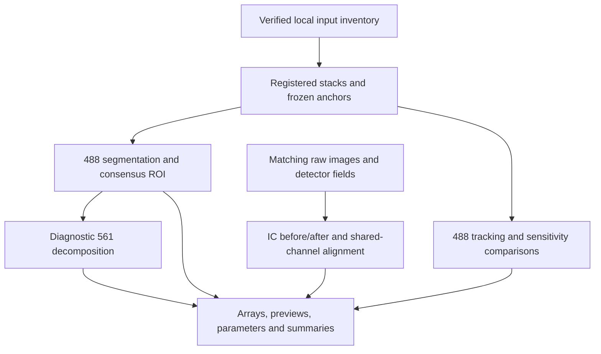

# Inputs, outputs, and portable execution boundaries

The source-level pipeline guide is [PIPELINE_GUIDE.md](../diagnostics_20261027/PIPELINE_GUIDE.md). The portable workflow runs the same registered-track diagnostic functions locally. It must not silently substitute synthetic images for missing experimental inputs.

## Required inputs

| Input | Required content | Purpose and limits |
| --- | --- | --- |
| Source checkout | Tested instrumentation plus the current portable scripts and continuation notes | Supplies processing functions and versioned parameters. Record the actual commit and any local changes. |
| Frozen atlas master CSV | Original neuron IDs, day/time indices, registered-stack anchors and source-stack references | Declares the original tracking geometry. Preserve original bytes and a checksum; local file mapping should be separate from the original master. |
| Six registered TIFF stacks | E05, F05, I05, J05, M05, N05; one explicit `TCYX` series each; nine visits and three channels | Supports broader tracking, segmentation, ROI, and phenotype diagnostics. These pixels have already been registered; do not transform them again as though they were raw. |
| Dataset manifest/transfer inventory | Local file mapping, source identifiers, sizes, hashes, required/missing states | Makes the portable copy auditable. It must distinguish a verified transfer from a referenced-but-absent source. |
| Diagnostic configuration | `configs/tmem_stage_diagnostics.json`, or an explicitly recorded validated alternative | Sets primary parameters and predeclared sensitivity ranges. Do not select a preferred setting from 561 outcomes. |
| Existing returned evidence packet | `TMEM106B_stage_implementation_results_20261027.zip` and its receipt/inventory | Preserves completed verification and three-case results. It does not contain a newly accepted biological cohort. |

The original master SHA256 recorded by the returned run is `4d1a7c224cea385562492601859ac90fb29228070539ce13ca79598341d12390`. If a different master is intentionally used, record it as a new input rather than claiming the original binding.

The declared channel order is index 0 = 405, index 1 = 561, index 2 = 488. The nine days are **8, 12, 16, 20, 25, 29, 32, 36, and 39**, with time indices 0 through 8. A declared label/order is not independent verification of microscope settings.

Coordinates use YX order. Bounding boxes are zero-based, half-open `y0:y1, x0:x1`; atlas anchors and boxes refer to the registered-stack frame. Saved crops have their own local frame. Translation outputs use `(dy, dx)`, moving image to reference image. LUT-constrained boxes are viewing proposals and do not replace measurement geometry.

## Processing flow

The raw-input branch is executable only when the declared raw inputs and correction fields are actually present. It does not become available because a registered stack exists.

## Outputs to retain

| Output | What it records |
| --- | --- |
| Session/benchmark summary | Selected candidates, resolved settings, execution budget, completed/failed/timed-out/deferred cases, and explicit scientific non-acceptance states. |
| Per-track `index.html` | A browsable gallery of the saved processing steps. Image previews are display products; underlying arrays remain the numerical evidence. |
| `stages/<stage>/array.npy` | Actual observed numeric values with original shape/dtype, written without pickle. |
| `stages/<stage>/preview.png` and `stage.json` | Fixed-LUT view plus operation purpose, parents, parameters, statistics, and hashes. |
| `manifest.json` and `provenance.json` | Finalized file inventory, ancestry, execution states, input/code bindings, and configuration. A finalized manifest can contain skipped or unavailable stages. |
| `tracking_comparison.json` | Candidate anchors at each declared search radius, match scores, displacement from stored anchors, and non-adoption flags. Stored anchors are comparison references, not established ground truth. |
| `parameter_sensitivity.json` | Each declared area setting, valid-visit counts, mask overlap, core construction/rejection and area. |
| `secondary_soma_screen.json` | Informational secondary-object checks. Passing does not establish ROI ownership. |
| `diagnostic_phenotype_metrics.json` | Diagnostic 561 calculations when geometry permits. These are not accepted measurements. |
| Verification logs/XML and push receipt | Which checks actually ran and which commit was pushed. Historical receipts remain separate from new local results. |

## What goes to GitHub

Commit code, tests, configurations, the Markdown explanation of results, and compact non-image summaries needed to reproduce the reasoning. Keep raw/registered microscopy files, generated galleries/NPY/PNG files, virtual environments, archives, and full execution logs in the external data/results location. Retain a checksum inventory and explicit relative references so another device can reconnect them.

The returned packet is approximately 83 MB and contains nested diagnostic archives. A Git commit of the packet would not substitute for the six-well portable dataset and would unnecessarily enlarge the repository.

## Real IC before/after requirements

The raw-pair diagnostic accepts a reference and moving image with explicit `CYX` axes, a matching pickle-free flatfield NPY declared in detector coordinates, and documented darkfield/background choices. A scalar darkfield of zero is not a measured camera calibration. Source paths, channel order, image coordinates, correction-field shape, and provenance must agree before the result can support a real-image correction comparison.

The existing synthetic verification establishes software behavior on a known fixture. The latest three experimental registered-track reports mark historical raw input, IC, stitching, and registration as unavailable. Preserve those limitations when summarizing the workflow to collaborators.
