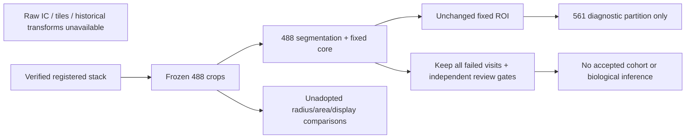

# Six-well local review handoff

This is an expanded **diagnostic** panel, not a validated biological cohort. The original three controls were reused as historical evidence, not rerun or counted as new replicates. No production processing, anchors, mask parameters, ROI geometry, or acceptance policy changed. The portable source snapshot and a read-only review/reporting tool are the software additions.

## What to inspect

The local `../review-local/index.html` links each case's large nine-visit 488 contact sheet, larger registered 488 search context, full stage gallery, provenance, compact numeric comparison, and a blank source-hash-bound `review_template.csv`. The report reads no 561 data. Numeric arrays stay in `../benchmark-local/tracks/<ID>/stages/`; per-case `manifest.json` binds their file and array hashes. Each operation retains parameters, ancestry and an explanation. Display enlargement and colored proposal markers never feed measurements back into the pipeline.

White cross: frozen original anchor. Cyan/magenta/orange circles: unadopted radius-40/60/80 tracking proposals. Yellow outline: unchanged identity core; red: unchanged phenotype ROI. White rectangles in larger search views are the original 128-pixel measurement crops, not proposed new geometry. The saved `raw_search` stage means registered 488 pixels before local normalization; it is **not** a raw detector image.

## Provisional image triage

Agent inspection is not independent expert labeling and does not establish accuracy, true neuron identity, or ownership. These observations flag where review is needed; do not convert them into accepted IDs.

| Case | Actual 488 image observations requiring review |
|---|---|
| E05_N057 | Central signal becomes dim/fragmentary; two failed primary visits. Larger searches sometimes select a spatially separate bright object or a low-signal location. |
| F05_N005 | Multiple neighboring objects, especially later visits. Wider searches visibly depart from the centered object; primary ROI ownership still needs confirmation despite 9/9 mask validity. |
| I05_N052 | Dim central signal on some visits; alternatives select nearby separate objects. Neighboring bright structures approach the ROI on later visits. |
| J05_N029 | Central signal nearly absent at Day16; several failed primary visits. Some alternative proposals fall on neighboring structures or outside the fixed crop. |
| M05_N009 | Main 488 object persists near the anchor with nearby objects below/above. Day25 is dimmer and the radius-80 proposal selects an upper neighbor. |
| N05_N010 | Persistent lobed/crescent-shaped support; stable-looking geometry alone cannot establish whether all support belongs to one soma. Later wide searches select other objects. |
| E05_N066 | Large fixed core encloses several spatially distinct bright structures at Day8; later the frozen anchor lies above the main remaining bright structure. Strong multi-object/ownership concern, despite the automated single-soma pass. |
| F05_N061 | Two-lobed/disconnected-looking support below the anchor; failed visits and distant proposals. Fixed ROI ownership is unresolved. |
| I05_N006 | Bright neighboring structure abuts the right/top of the fixed core on several visits. All-nine automated validity does not settle the boundary concern. |
| J05_N028 | Large irregular ROI extends around neighboring structures and low-signal regions. Several failed visits; later bright structures cross its boundary. |
| M05_N022 | Elongated support amid many neighboring objects; dim later visits and distant alternative matches. The lower extension of the fixed ROI needs ownership review despite 9/9 validity. |
| N05_N022 | Nearby structures approach the boundary on later visits. Day39 has no sufficient central 488 signal, an inherited failed tracking flag and an empty invalid mask; no rescue attempted. |

These observations do **not** justify a global radius reduction: radius-40 proposals also visibly select alternative neighboring objects in some cases. Neither a smaller displacement nor a higher match score is ground-truth accuracy.

## Scientific readiness

| Requirement | Evidence / remaining gate |
|---|---|
| Registered six-well inputs and nine visits | Verified locally; no required packaged dataset file missing. |
| Software controls and instrumented pipeline | Fresh Mac results saved separately from historical Biowulf evidence. |
| Same-panel comparison | Frozen anchors and primary area=180/radius=60 compared with declared area 140/220 and radius 40/80 alternatives on the same IDs. Alternatives unadopted. |
| Identity error rate / tracking accuracy | **Not established:** no independent identity labels supplied for this panel. Report agreement and sensitivity only. |
| ROI contamination / ownership accuracy | **Not established:** provisional visual concerns and mask-overlap diagnostics are not reviewed boundary truth. |
| Real-image IC, stitching and historical alignment | **Unavailable:** need matching detector-coordinate raw images, correction fields with provenance, tile placement and original transforms/before-images. Registered stacks cannot reconstruct them. These inputs may be validated locally once supplied; NIH access is not inherently required. |
| Accepted matched-well phenotype analysis | **Blocked:** zero newly accepted tracks; preserve every failed visit and historical exclusion. No biological inference or partial-visit accepted export. |

## Next local actions (no unchanged reruns)

1. Inspect final execution counts in `../benchmark-local/benchmark_summary.json` and the compact committed local-results receipt. Do not rerun the benchmark just to reproduce the panel: documentation now mentions the selected IDs, and its dynamic documented-example exclusion scan would select a different panel. Preserve this run's frozen ID list, exclusions, seed and archived source snapshot.
2. Open the existing review index and complete `review_template.csv` independently, using 488 only for identity/ROI review. Annotate all nine visits, mark uncertainty explicitly, and retain reviewer/source hashes. Blank rows are not approvals. This sheet is an annotation aid, not an acceptance/export command.
3. Reconcile reviewed labels with historical exclusions and all-nine-visit gates using the existing audited review workflow. Do not repair anchors, shrink geometry, or select settings based on 561 outcomes to obtain acceptance.
4. Only after declared geometry and review gates are fixed, evaluate independent 561 phenotype outputs and matched-well requirements. Neurons remain nested within six wells; repeated visits and stage records do not add biological replicates.
5. Obtain the exact missing raw/correction provenance if real-image IC/alignment validation is required. Do not invent historical before/after images.

From this repository on the current Mac:

```bash
open ../review-local/index.html
```

If the report has not been generated, first inspect run status, then use the single report command in [CODEX_NEXT.md](CODEX_NEXT.md) with a **new** output directory. Preserve completed outputs. GitHub contains intended source, tests, notes and compact technical summaries only; the dataset, environment and generated galleries travel separately.

## Compact processing flow


