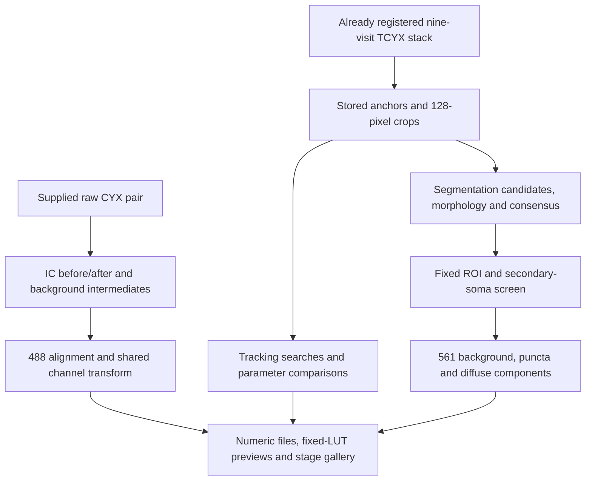

# Inspect the TMEM106B pipeline one operation at a time

This diagnostic workflow makes the existing processing functions inspectable. It saves the numeric input/output of each observed operation, its display preview, its parameters, and its purpose. It does not establish a new accepted cohort or a biological result. A completed trace can include explicit skipped or unavailable stages; inspect their states before drawing conclusions.



The raw-pair and registered-track routes are separate executions. A registered stack does not supply historical IC or stitching intermediates. The gallery can be filtered by step name, channel and execution status; numeric files remain the evidence behind each preview.

## Choose the input route

| Route | Required image I/O | What actually runs | What remains unresolved |
| --- | --- | --- | --- |
| `registered-track` | Already registered TIFF, `TCYX`, nine visits, three channels; atlas master CSV; one neuron ID | Existing atlas boxes, diagnostic 488 tracking comparison, adaptive segmentation, tight longitudinal consensus, fixed ROI, 561 phenotype decomposition, and parameter sensitivity | Historical raw preprocessing, IC fields, stitching and registration cannot be recovered from the registered stack alone. They are recorded as unavailable. No IC or geometric transform is reapplied. |
| `raw-pair` | Explicit reference and moving arrays, `CYX`, three channels; `.npy` or TIFF; matching optional flatfield `.npy` and scalar darkfield | Preprocessing in detector coordinates, then a moving-to-reference translation estimated from channel index 2 and applied once to every moving YX plane | This two-image diagnostic does not validate nine-visit identity, mosaics, physical calibration, or the provenance of a supplied correction field. |

The declared channel order is index 0 = 405, index 1 = 561, index 2 = 488. The reader validates the declared shape/axes; a channel label is not independent verification of microscope settings. Days are 8, 12, 16, 20, 25, 29, 32, 36 and 39. All spatial boxes use zero-based, half-open `y0:y1, x0:x1` coordinates. Atlas anchors and boxes refer to registered-stack coordinates; a crop has its own local YX coordinates. Recorded transforms are `(dy, dx)`, moving to reference.

**Existing registered pixels already include their historical transform.** Subtracting that transform again would move them twice. The registered route therefore observes the supplied stack and atlas geometry without rewarping either one.

## Run the diagnostic CLI

Run image processing inside a Biowulf Slurm allocation using the project's existing Python environment. Give each run a new output directory; traces refuse to overwrite an existing trace. Use the launcher's recorded checkout and input paths rather than selecting an arbitrary recent directory.

```bash
test -n "${SLURM_JOB_ID:-}"
export PYTHONPATH="$PWD/src${PYTHONPATH:+:$PYTHONPATH}"

python scripts/trace_tmem_pipeline.py registered-track \
    --stack /path/to/E05_registered_common_overlap_tcyx.ome.tif \
    --master /path/to/all_neurons_longitudinal_master.csv \
    --neuron-id E05_N006 \
    --config configs/tmem_stage_diagnostics.json \
    --out /path/to/NEW_E05_N006_diagnostic
```

To inspect a genuine raw image pair:

```bash
test -n "${SLURM_JOB_ID:-}"
export PYTHONPATH="$PWD/src${PYTHONPATH:+:$PYTHONPATH}"

python scripts/trace_tmem_pipeline.py raw-pair \
    --reference /path/to/reference_cyx.npy \
    --moving /path/to/moving_cyx.npy \
    --flatfield /path/to/declared_flatfield.npy \
    --flatfield-coordinate-system detector \
    --darkfield 0 \
    --background-radius 100 \
    --config configs/tmem_stage_diagnostics.json \
    --out /path/to/NEW_raw_pair_diagnostic
```

The flatfield, darkfield and background-radius options are optional. A supplied flatfield requires the explicit detector-coordinate declaration. Omitting a correction records it as skipped; it does not imply that the image was already corrected. A scalar darkfield of zero must not be presented as a measured camera offset. Use `--config /path/to/validated_config.json` for a custom configuration, and inspect the resolved configuration saved with the output. `--help` on each subcommand gives the implemented interface.

## Read the bite-sized outputs

Open a trace's `index.html` in a browser. Each card names the operation and states why it exists. Its links expose the numeric array, preview, JSON details and parents. The PNG is a visualization; use the saved array for pixel-level comparisons.

| Artifact | Meaning and audit use |
| --- | --- |
| `provenance.json` | Input provenance supplied by the caller: source identifiers, axes/channel declaration, coordinate system and resolved settings. Supplied metadata is not independent scientific validation. |
| `stages/<stage>/array.npy` | Exact observed finite numeric array, saved without pickle. Shape and dtype are retained; booleans represent masks and integer labels represent components. |
| `stages/<stage>/preview.png` | Display-only RGB image. A multichannel/time stage explicitly identifies the selected channel and first timepoint; it is not a projection. |
| `stages/<stage>/stage.json` | Operation purpose, parameters, parent-stage names, array statistics, display policy, and artifact hashes. |
| `processing_flow.mmd` | Mermaid graph generated from the recorded stage ancestry and execution states. The source-level route overview is [processing_flow.mmd](processing_flow.mmd). |
| `in_progress.json` | Crash-readable ledger while capture is unfinished. Its presence is not a successful execution receipt. |
| `manifest.json` | Final file inventory and hashes, ordered stage records, execution-state counts and diagnostic summary. `complete` means recording finished; `successful_execution` and `all_declared_stages_executed` answer different questions. Neither grants approval. |
| `summary.json` | Software execution status, diagnostic status and explicit production/science/acceptance boundaries. |
| `crop_geometry.json` | Registered-track visit boxes and anchors in the registered frame and crop frame. |
| `display_only_lut_bbox_proposals.json` | Per-visit 488 viewing-box proposals, support rules and non-adoption state. |
| `tracking_comparison.json` | Diagnostic candidate anchors, historical flags/scores, displacements, nearest other stored-ID anchor and every declared search radius. Stored IDs are not biological ground truth. |
| `parameter_sensitivity.json` | Each minimum-area setting, visit mask areas and IoU versus the baseline, validity and core construction/rejection. No preferred setting is chosen. |
| `diagnostic_phenotype_metrics.json` | Registered-track diagnostic calculations when a core exists; empty when the core cannot be constructed. These are not accepted measurements. |

Every observed numeric stage has an array-content hash binding values, shape and dtype, plus file hashes for the NPY, PNG and JSON artifacts. The manifest verifies the complete finalized inventory. A stage's `why` explains the operation; its statistics describe the saved result rather than an inferred biological event. `skipped` and `unavailable` stages contain no invented numeric output. A `failed` stage preserves the actual failure path.

Known segmentation/core rejections can still produce a completed software execution and CLI exit 0: `summary.json` then records `diagnostic_status="diagnostic_rejected"`. A route that executes its calculations without that rejection records `diagnostic_complete_pending_review`. Both retain `production_eligible=false`, no accepted IDs and no scientific approval. Unexpected software/input failures remain nonzero exits. Read the diagnostic state and retained stage failures, not only the shell exit code.

To verify one finalized trace:

```bash
PYTHONPATH=src python -c \
  'import sys; from tmem_align.audit_v1.stage_trace import verify_trace; print(verify_trace(sys.argv[1])["stage_status_counts"])' \
  /path/to/TRACE_DIRECTORY
```

## What each operation changes, and why

| Operation | Before, intermediate and after evidence | Purpose and limitation |
| --- | --- | --- |
| Input and crop | Raw/registered arrays, source axes, original atlas anchor, exact crop bounds | Establish which pixels are being inspected. A centered box alone does not establish neuron identity. |
| Darkfield | `00_before_ic`, `01_dark_subtracted_float` | Subtract a supplied camera offset in float; clamp negative residuals to zero. No darkfield supplied means skipped. |
| Flatfield / IC | `02_ic_field`, `03_after_ic_float` | Divide dark-corrected pixels by the supplied positive field. Save the actual divisor and its broadcast shape. A supplied field needs source and coordinate provenance. |
| Background subtraction | `04_background_estimate`, `05_after_background_float` | Show the background removed by the actual rolling-ball call. The estimate is computed from that call's input/output, not from a second filter execution. |
| Final preprocessing pixels | `06_downstream_input` | Show the exact array passed onward. IC and background remain float until a single rounded/clipped uint16 conversion; a complete no-op returns the unchanged input. |
| Registration | Reference/moving, estimation inputs, foreground masks when used, aligned image and transformed support | Estimate a 488 translation and apply it independently to YX planes. Fill pixels and image support are separate from measured dark signal. Masked phase error is undefined; it must not be reported as a numeric accuracy score. |
| Tracking | Raw template crop, normalized/smoothed template, mean subtraction, scaled template, raw/normalized search, correlation surface and chosen peak | Reveal which object won within the bounded search. High correlation is not proof that the winner is the original neuron. Diagnostic anchors do not replace stored anchors. |
| Adaptive segmentation | Raw/normalized/smoothed 488, seed/prior/allowed support, each threshold, small-object removal, closing, hole fill, labels, component scores and selected mask | Identify the exact branch that chose, merged or rejected a candidate. Inspect neighbor ownership and prior overlap as well as area. |
| Longitudinal identity | Visit masks and validity, vote counts, consensus, closing, filled holes, small-object removal, selected core | Require at least three valid 488 masks and preserve the original consensus/core-area rules. An inherited tracking flag remains inherited evidence. |
| Phenotype support | Fixed ROI and background-exclusion support | Fix geometry from 488. The 561 image does not select the soma, move its anchor or change the measurement mask. |
| 561 decomposition | Raw 561, background estimate/support, corrected 561, DoG response, puncta candidates/filtered labels, diffuse support/intensity | Expose each computational definition. “Diffuse” is an algorithmic residual and can retain localized signal; puncta are not independently established fibrils. |

IC uses `max(raw - darkfield, 0) / flatfield` before registration, in the field's detector coordinate system. The high-level preprocessing entry point rejects nonpositive/nonfinite fields and ambiguous shapes. Its lower-level legacy `apply_ic_field` retains an older zero-field fallback; that fallback is not evidence that a zero physical field is valid. Correction-field estimation from an image collection and a historically validated calibration are separate matters.

## Visualization hook and LUT-constrained boxes

`tmem_align.audit_v1.visualization.render_preview` is the small extension point for a future viewer. It accepts one YX image, an explicit `LUT`, optional spatial `Bounds`, and full-image boolean overlays. It returns an independent, read-only RGB preview. A UI can wrap this function without changing quantitative pixels or supplying display pixels back to preprocessing.

```python
from tmem_align.audit_v1.contracts import Bounds
from tmem_align.audit_v1.display import LUT
from tmem_align.audit_v1.visualization import render_preview, propose_lut_bbox

lut = LUT(100, 3000, "488")  # Explicit viewing limits in stored pixel units.
rgb = render_preview(image488, lut, bounds=Bounds(0, 128, 0, 128))
proposal = propose_lut_bbox(
    image488, lut, anchor_yx=(64.0, 64.0),
    search_bounds=Bounds(0, 128, 0, 128),
    padding=2, min_area=40, range_policy="visible",
)
```

The displayed limits in this example are illustrative settings, not a validated intensity threshold or camera calibration. A LUT maps intensities to RGB; `Bounds` selects spatial pixels. The proposal links the two only for an explicitly unadopted viewing suggestion:

- `visible` includes pixels above the lower LUT limit, including pixels clipped at the upper display limit. Changing only the upper display limit cannot remove a bright soma from this support.
- `within_range` explicitly uses `low < pixel <= high` and records the deliberate exclusion of clipped-high pixels.
- Proposals use eight-connected **488** components inside the declared search box. An anchor selects its containing component using the floored pixel index; an unsupported anchor returns a reason instead of jumping to a neighbor. Without an anchor, the largest eligible component is selected with a deterministic tie break.
- Padding is clipped to the search box. Original-image coordinates, LUT, support rule, component counts and source hash are recorded. A proposal never updates an atlas anchor, segmentation core, phenotype ROI, tracking flag or review decision.

Intensity previews use fixed declared limits for comparable stages. Boolean masks use 0–1 display; labels use categorical colors; normalized, correlation, signed-response and field stages declare their own display domains. Display clipping is not quantitative clipping or proof of camera saturation.

## Tune parameters without selecting a preferred phenotype

Keep the resolved baseline configuration, and compare a declared grid on the same source pixels. The diagnostic segmentation grid is minimum area 140/180/220 pixels; the tracking-search grid is radius 40/60/80 pixels. The diagnostic template is 41 pixels across and its baseline search radius is 60 pixels. These are sensitivity settings, not newly adopted production defaults.

The committed [configuration](../../configs/tmem_stage_diagnostics.json) declares `schema_version="tmem.stage_diagnostics.v1"`. Partial custom settings merge with those defaults; unknown keys fail instead of being silently ignored.

| Configuration group/key | Unit and constraint | Meaning |
| --- | --- | --- |
| `bbox_size` | Fixed at 128 pixels | Preserve the existing crop contract. |
| `segmentation.min_area` | Integer pixel area; default 180 | Adaptive candidate-discovery setting, not an independent identity test. |
| `segmentation.consensus_fraction` | Fraction; default 0.6 | Required longitudinal support, alongside the unchanged minimum of three valid masks. |
| `segmentation.min_core_area`, `max_core_area` | Integer pixel areas; minimum cannot exceed maximum | Reject implausible consensus area; a passing area alone does not establish purity. |
| `segmentation.phenotype_dilation` | Integer radius in pixels; default 2 | Derive the fixed diagnostic ROI from the core. |
| `segmentation.background_exclusion`, `puncta_min_size` | Pixel radius / pixel area; defaults 8 / 6 | Background support exclusion and computational puncta filtering. |
| `tracking.template_size`, `search_radius`, `min_score` | Odd integer width / integer radius / correlation score; defaults 41 / 60 / 0.25 | Independent diagnostic tracking comparison; original master positions remain the references. |
| `registration.upsample_factor`, `max_shift_pixels`, `robust_preprocess`, `mask_percentile` | Defaults 10 / 256 pixels / false / 20th percentile | Raw-pair 488 estimation. Masked correlation has integer-pixel resolution and undefined phase error; robust preprocessing and masked estimation cannot be combined in this diagnostic configuration. No registration runs in registered-track mode. |
| `secondary_soma` | Search radius52 pixels, peak distance14 pixels, peak ratio0.55, area ratio0.30, score threshold0.40 | Observe the existing automated neighbor screen on the valid-visit 488 reference. A screen pass does not establish single-neuron ownership. |
| `sensitivity` grids | Distinct sorted integer lists, 1–9 values each and at most nine total | Bounded one-parameter comparisons; no best setting is selected. |
| `luts`, `lut_box` | Finite display limits, validated spatial proposal settings | Display and unadopted viewing suggestions only. |

Inspect changes in component count, selected threshold, mask area, prior overlap, core/ROI ownership, candidate anchor and template-match score. Search radius is a distance in image pixels; minimum area is a count of pixels; a template size is a width in pixels. Larger search windows can reach neighboring cells. Smaller area gates can admit fragments. Larger masks or a stronger score can reflect merged or wrong objects. Configuration validation catches invalid values but cannot choose biologically correct values.

The grid must retain failures and unadopted alternatives. Do not choose a parameter using 561 phenotype size, group separation, later outcome, or a desired accepted-track count. A new configuration or geometry requires its own bound evidence and review; passing a sensitivity execution does not rescue the original excluded packet.

## Unit tests, integration tests and real-data evidence

Use the existing project environment. Missing required dependencies mean a test is unrun; they do not count as a pass. The commands below do not install packages. Run pixel-processing tests inside a Slurm allocation.

```bash
test -n "${SLURM_JOB_ID:-}"
export PYTHONPATH="$PWD/src${PYTHONPATH:+:$PYTHONPATH}"
python -m unittest discover -s tests/audit_v1 -p 'test_stage_trace.py' -v
python -m unittest discover -s tests/audit_v1 -p 'test_visualization.py' -v
python -m unittest discover -s tests/audit_v1 -p 'test_segmentation_trace.py' -v
python -m unittest discover -s tests/audit_v1 -p 'test_pipeline_diagnostics.py' -v
python -m unittest discover -s tests -p 'test_preprocess_trace.py' -v
python -m unittest discover -s tests -p 'test_registration_trace.py' -v
```

With the project's declared development dependency `pytest` already available, run the affected original numerical regressions as well:

```bash
test -n "${SLURM_JOB_ID:-}"
PYTHONPATH=src python -m pytest \
    tests/test_preprocess.py \
    tests/test_preprocess_integration.py \
    tests/test_register.py \
    tests/audit_v1/test_historical_ic_fixtures.py
```

Recorder tests verify hashes, parent order, output inventory, tampering rejection and explicit stage states. Visualization tests verify nonmutation, crop/overlay correspondence and LUT-proposal failure paths. Observer tests compare traced and untraced production outputs. Registration tests use a known displacement and test channel isolation; synthetic IC tests establish arithmetic behavior. None of those tests independently validates a historical microscope field or the identity of a real neuron. Record the actual test command, environment and exit status; do not copy a previous run's count into a new verification report.

Pipeline integration tests exercise the supplied raw-pair and registered-track routes through production functions, including rejected/unknown historical states and display-versus-quantitative separation. Real raw-pair correlation before/after is measured over geometric shared support and describes that pair only; it is not independent landmark accuracy or proof of soma identity. Compare the retained pixels and failures before claiming an improvement.

## Predeclared questions and the evidence needed to answer them

| Question | Expected diagnostic evidence | Falsification / unresolved condition | Measured status |
| --- | --- | --- | --- |
| Where did E05_N006 Day12 diverge from the original 488 object? | Compare stored anchor/crop, search window, correlation winner, component scores, and neighboring Day8/16 context. | A good match score on another object, or unresolved ownership, fails identity. An inherited flag cannot validate a new anchor. | Pending returned real diagnostic output. Original packet remains excluded. |
| Why is F05_N007 Day12 ownership unresolved? | Inspect raw 488, component labels, core and original ROI boundary at native pixels; retain the neighboring structure. | A cleaner display or smaller proposed preview box does not prove that the original ROI contains one soma. | Pending returned real diagnostic output. Original packet remains excluded. |
| Does the recorder change the algorithm? | Compare traced and untraced arrays, metadata and failure paths on identical inputs/configuration. | Any numeric/mask/anchor difference attributable to recording fails the observer contract. | Report actual unit/integration result; no result asserted here. |
| What does IC change on this raw pair? | Compare exact pre/post float arrays with the same viewing LUT; retain field/dark provenance and final quantization. | No valid field, wrong coordinates, arbitrary field fitting, or an apparent change caused only by display scaling prevents a physical IC conclusion. | Pending genuine raw-pair evidence and field provenance. |
| Are these masks/anchors stable to a declared parameter range? | Complete sensitivity table including failures, displacement, area, overlap and component changes. | Switches to a neighbor, mergers or unstable support prevent a robustness claim. | Pending returned sensitivity results. |

J05_N015 can be a technical reference example; its historical technical-only status does not establish a new biological cohort. The current reviewed candidate packets remain excluded and construction failures remain blocked. All nine visits, original QC rules, exact source/render provenance and review policy still apply. No diagnostic trace writes accepted metrics or grants scientific inference.

The immediate implementation gain is inspectable, source-bound evidence and testable failure localization. A scientific improvement requires a measured result against a declared criterion on appropriate data. Biological knowledge additionally needs validated identities, measurement provenance, suitable controls and independent well/pair replication. Keep those claims separate when reporting to collaborators.
